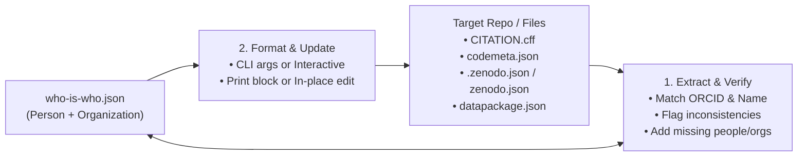

# Centralised Author & Contributor Metadata Management (`who-is-who`)

## Goal Description

Maintain [who-is-who.json](file:///Users/z3529065/proyectos/EIW/PID-implementation-scripts/who-is-who.json) as a single source of truth for `Person` and `Organization` metadata across Ecosystem Indicators Workflows (EIW) repositories, and provide reusable Python functions plus an interactive/CLI script inside [PID-implementation-scripts](file:///Users/z3529065/proyectos/EIW/PID-implementation-scripts) to:

1. **Extract & Verify**: Parse author/contributor blocks from `CITATION.cff`, `codemeta.json`, `zenodo.json` / `.zenodo.json`, and `datapackage.json` in any target repository or file; match records against `who-is-who.json`; flag inconsistencies (e.g. copy-pasted/conflicting ORCIDs, missing ORCIDs/emails, name or initial differences, affiliation mismatches); and optionally add missing persons/organizations (or enrich missing fields) in `who-is-who.json`.
2. **Format & Insert/Replace**: Select ordered authors and contributors (via CLI arguments or interactive prompts) and generate formatted blocks—either printed to stdout/returned by Python functions or surgically inserted/replaced in-place in target repository files while preserving all surrounding metadata and comments.



---

## User Review Required

> [!IMPORTANT]
> **Zero Mandatory External Dependencies (PEP 668 Safe)**
> Global Homebrew Python 3.13 on macOS enforces PEP 668 (`externally-managed-environment`) and does not have `PyYAML` installed globally. The tool will run out-of-the-box with **Python 3 standard library only**:
> - For `CITATION.cff`, it will use `PyYAML` automatically if available in an active environment, with a built-in CFF YAML `authors:` block parser fallback so no virtual environment is required.
> - In-place updates to `CITATION.cff` will surgically replace **only** the top-level `authors:` block rather than re-dumping the entire YAML document, preserving `# cffinit` comments, `title: >-` / `message: >-` folded blocks, key ordering, and single-quoted strings.

> [!NOTE]
> **Partial Block Updates Preserve Unspecified Blocks**
> For multi-block files (`codemeta.json` with `author` + `contributor`, `.zenodo.json` with `creators` + `contributors`, and `datapackage.json` with `role: "author"` + `role: "contributor"`):
> - Passing only `--authors` updates the author/creator entries while leaving existing contributor entries intact unless `--contributors` or `--clear-contributors` is explicitly passed.
> - Passing only `--contributors` updates contributors while leaving existing authors/creators intact.

---

## Proposed Changes

### 1. Centralised Registry Schema (`who-is-who.json`)

#### [MODIFY] [who-is-who.json](file:///Users/z3529065/proyectos/EIW/PID-implementation-scripts/who-is-who.json)
Extend existing `Person` entries with short `code` identifiers (for ergonomic CLI selection alongside surname/ORCID matching) while keeping all new fields optional:

- **`Organization` entry**:
  - `code` *(required, str)*: short slug, e.g. `"ces"`, `"iucn-cem"`, `"unsw"`, `"jcu"`, `"qcif"`, `"ardc"`
  - `name` *(required, str)*: canonical display name
  - `@id` *(optional, str)*: ROR or persistent URI, e.g. `"https://ror.org/00ybvyr04"`
- **`Person` entry**:
  - `code` *(optional, str)*: short unique slug for CLI selection (e.g. `"jrfp"`, `"mtozer"`, `"dkeith"`, `"eaddicott"`, `"egould"`, `"asingh"`; auto-suggested when adding new people)
  - `givenName` *(required, str)*: e.g. `"J. R."`
  - `familyName` *(required, str)*: e.g. `"Ferrer-Paris"`
  - `@id` *(optional, str)*: full ORCID URL (`"https://orcid.org/0000-0002-9554-3395"`), omitted when a person has no ORCID
  - `email` *(optional, str)*: e.g. `"j.ferrer@unsw.edu.au"`
  - `affiliations` *(optional, list[str])*: ordered list of `Organization.code` values

---

### 2. Core Python Package (`python/who_is_who/`)

All reusable functions live in an importable package under `python/who_is_who/`, paired with a direct CLI entrypoint script `python/manage-authors.py`.

#### [NEW] [__init__.py](file:///Users/z3529065/proyectos/EIW/PID-implementation-scripts/python/who_is_who/__init__.py)
Exports the public Python API so scripts or notebooks can call functions directly:
- `load_registry`, `save_registry`, `resolve_person`, `add_person`, `add_organization`
- `discover_metadata_files`, `extract_from_file`
- `verify_file`, `verify_repo`, `reconcile_interactive`
- `format_block`, `update_file`, `SelectSpec`

#### [NEW] [models.py](file:///Users/z3529065/proyectos/EIW/PID-implementation-scripts/python/who_is_who/models.py)
Dataclasses and normalization helpers:
- `Organization`, `Person`, `Registry`
- `ExtractedPerson`: normalized view of an entry read from any of the 4 file formats (`source_file`, `source_format`, `block_name`, `given_name`, `family_name`, `full_name`, `orcid`, `email`, `affiliations`, `role`, `raw`)
- `Inconsistency` & `VerificationResult`: structured issue reporting with severity/category:
  - `ORCID_CONFLICT`: extracted ORCID belongs to a *different* person in `who-is-who.json`, or contradicts the matched person's `@id` (catches copy-paste errors such as two authors sharing an ORCID)
  - `MISSING_IN_FILE`: `who-is-who.json` has `@id` (ORCID) or `email`, but the target file omits it
  - `MISSING_IN_REGISTRY`: target file has an `orcid` or `email` missing from the matched person in `who-is-who.json` (can be synced back into `who-is-who.json`)
  - `NAME_MISMATCH`: `givenName` or `familyName` differs in initials, spelling, or diacritics (e.g. `"David A."` vs `"David"`, `"José R."` vs `"J. R."`)
  - `AFFILIATION_MISMATCH`: file affiliation strings do not match resolved `Organization.name` / `code` values in `who-is-who.json`
  - `SCHEMA_WARNING`: e.g. `datapackage.json` using non-Frictionless keys (`name`/`affiliation`/`orcid` instead of `title`/`organization`/`path`)
- Normalization utilities:
  - `normalize_orcid(value)`: accepts bare `0000-0002-9554-3395` or `https://orcid.org/...`, validates format/checksum structure, and converts to canonical URI (`https://orcid.org/...`) or bare ID (`0000-...`) as required by each output format.
  - `fold_text(value)`: Unicode NFKD accent folding + whitespace normalization for matching `"José"` <-> `"Jose"`.

#### [NEW] [registry.py](file:///Users/z3529065/proyectos/EIW/PID-implementation-scripts/python/who_is_who/registry.py)
Registry CRUD and flexible person/organization lookup:
- Default path resolved automatically relative to the repo root (`<PID-implementation-scripts>/who-is-who.json`), overridable via `registry_path` argument or `--registry`.
- `resolve_person(query)`: resolves a selector token by exact `code`, normalized ORCID, exact `familyName` (warning/erroring if ambiguous), `"Family, Given"` / `"Given Family"`, or 1-based list index.
- `match_extracted_person(extracted, registry)`:
  1. Checks both ORCID match and normalized name match (`familyName` + compatible `givenName`/initials, plus `difflib` fuzzy fallback).
  2. Cross-checks ORCID match against name match so an ORCID belonging to Person A attached to Person B's name is flagged as `ORCID_CONFLICT` rather than silently mis-matching.
- `add_person_from_extracted(...)` / `add_organization(...)`: maps affiliation names to existing `Organization` records (by normalized name or `code`) or prompts/creates new `Organization` codes, auto-generates a non-colliding `Person.code` slug (e.g. `jbalmer`), and writes 4-space indented JSON to `who-is-who.json`.

#### [NEW] [extractors.py](file:///Users/z3529065/proyectos/EIW/PID-implementation-scripts/python/who_is_who/extractors.py)
File discovery and format-specific extractors:
- `discover_metadata_files(target_path)`:
  - If `target_path` is a file, detects its format (`cff`, `codemeta`, `zenodo`, `datapackage`).
  - If `target_path` is a directory/repository, recursively discovers `CITATION.cff`, `codemeta.json`, `.zenodo.json`, `zenodo.json`, `*zenodo*.json` templates, and `datapackage.json` (ignoring `.git`, `.venv`, `renv`, `node_modules`, `__pycache__`).
- Format parsers:
  - **CFF (`CITATION.cff`)**: extracts `authors` (`given-names`, `family-names`, `name`, `orcid`, `affiliation` split on `;`, `email`). Uses `yaml.safe_load` if installed, else built-in indentation-aware CFF `authors:` parser.
  - **CodeMeta (`codemeta.json`)**: extracts `author` and `contributor` (`givenName`, `familyName`, `@id`, `email`, and `affiliation` supporting both single `Organization` dict and list of `Organization` dicts).
  - **Zenodo (`.zenodo.json` / `zenodo.json`)**: supports both top-level `creators`/`contributors` and `{"metadata": {"creators": ..., "contributors": ...}}` wrapper templates; splits `"Family, Given"` names; extracts `orcid`, `;`-separated `affiliation`, and contributor `type`.
  - **Data Package (`datapackage.json`)**: extracts `contributors`, supporting **both** Frictionless standard (`title`, `path`, `email`, `organization`, `role`) and Zenodo-style (`name`, `orcid`, `affiliation`, `role`, flagging a `SCHEMA_WARNING` so the user knows it can be standardized).

#### [NEW] [formatters.py](file:///Users/z3529065/proyectos/EIW/PID-implementation-scripts/python/who_is_who/formatters.py)
Canonical block formatters and surgical in-place file updaters:

| Target File | Block(s) | Output Mapping from `who-is-who.json` |
| :--- | :--- | :--- |
| **`CITATION.cff`** | `authors` | `given-names`, `family-names`, `email` *(if present)*, `affiliation` *(org names joined with `"; "`)*, `orcid` *(`'https://orcid.org/...'` if `@id` present)* |
| **`codemeta.json`** | `author`, `contributor` | `{"@type": "Person", "givenName": ..., "familyName": ..., "@id": "https://orcid.org/...", "email": ..., "affiliation": [{"@type": "Organization", "name": ..., "@id": "https://ror.org/..."}]}` *(omitting absent optional keys)* |
| **`.zenodo.json` / `zenodo.json`** | `creators`, `contributors` | `{"name": "Family, Given", "affiliation": "Org 1; Org 2", "orcid": "0000-0000-0000-0000"}` + `"type": "<ZenodoRole>"` on `contributors` (validated against Zenodo's 21 controlled contributor types; default `"ProjectMember"`) |
| **`datapackage.json`** | `contributors` | Frictionless Data Package v1 standard: `{"title": "Given Family", "path": "https://orcid.org/...", "email": ..., "organization": "Org 1; Org 2", "role": "author" \| "contributor"}` |

- **In-place file updaters**:
  - `update_cff_authors(path, authors_list)`: locates top-level `authors:` block lines in `CITATION.cff` and replaces only that block (or inserts after `type:`/`message:`/`title:` if missing), preserving comments, `>-` multiline strings, and trailing newline style.
  - `update_json_blocks(path, format_type, authors=..., contributors=...)`: preserves existing JSON key order, detects root vs `{"metadata": ...}` in Zenodo files, detects existing indentation (2 vs 4 spaces), and updates only the requested block(s).

---

### 3. CLI & Interactive Tool (`python/manage-authors.py` & `python/who_is_who/cli.py`)

#### [NEW] [cli.py](file:///Users/z3529065/proyectos/EIW/PID-implementation-scripts/python/who_is_who/cli.py)
#### [NEW] [manage-authors.py](file:///Users/z3529065/proyectos/EIW/PID-implementation-scripts/python/manage-authors.py)

Provides subcommands supporting both non-interactive CLI arguments and interactive terminal prompts:

1. **`list`**: Display all `Person` and `Organization` entries in `who-is-who.json`.
   ```bash
   python3 python/manage-authors.py list
   ```
2. **`check` (Verify & Reconcile)**: Extract people from a target repo or file(s), report matches and inconsistencies, and optionally add missing people/organizations or enrich missing registry fields.
   ```bash
   # Check all metadata files discovered in another repository
   python3 python/manage-authors.py check --repo /path/to/target-repo

   # Check a specific file and interactively prompt to add missing people to who-is-who.json
   python3 python/manage-authors.py check --file /path/to/CITATION.cff --interactive
   ```
3. **`format` / `update` (Generate Blocks & Update Files)**:
   - Accepts `--authors` (ordered list, e.g. `jrfp,mtozer,dkeith`) and `--contributors` (with optional `:Role` per contributor, e.g. `egould:ProjectMember,asingh:ProjectMember`, or `--contributor-type ProjectMember`).
   - Can also copy the author list order from an existing file in the repo (e.g. `--from-file /path/to/CITATION.cff`) after resolving every person through `who-is-who.json`.
   - Modes:
     - **Print block only** (`format` subcommand, or `update --dry-run`): prints the formatted YAML/JSON snippet to stdout without modifying target files.
     - **Update in-place** (`update --in-place` / `-i`, or interactive confirmation): writes changes into the selected target file(s).
     - **Interactive mode** (`--interactive`, or automatically when invoked without `--authors`/`--contributors` on a TTY): prompts for target repo/files (if not passed), displays numbered roster from `who-is-who.json`, prompts for ordered author & contributor selection, previews generated changes, and asks confirmation before writing.
   ```bash
   # Print formatted CITATION.cff authors block to stdout
   python3 python/manage-authors.py format --format cff --authors jrfp,mtozer,dkeith

   # Update all metadata files in a target repo in-place via CLI arguments
   python3 python/manage-authors.py update \
     --repo /path/to/target-repo \
     --authors jrfp,mtozer,dkeith \
     --contributors egould:ProjectMember,asingh:ProjectMember \
     --in-place

   # Interactive guided workflow (select repo/files, authors, contributors, preview & apply)
   python3 python/manage-authors.py update --interactive
   ```

---

### 4. Documentation & Tests

#### [NEW] [test_who_is_who.py](file:///Users/z3529065/proyectos/EIW/PID-implementation-scripts/python/tests/test_who_is_who.py)
Standard-library `unittest` suite testing:
- Registry loading, saving, ORCID normalization, and selector resolution (`code`, surname, ORCID, full name).
- Extraction across all 4 formats, including edge cases found in real templates/examples:
  - Single-object vs array `affiliation` in `codemeta.json`
  - Top-level vs `{"metadata": ...}` wrapped Zenodo JSON (`metadata-templates/metadata.json` vs `metadata-examples/zenodo-metadata-24207312.json`)
  - Frictionless (`title`/`organization`/`path`) vs legacy (`name`/`affiliation`/`orcid`) `datapackage.json`
  - `CITATION.cff` with `#` comments, `>-` folded strings, and single-quoted ORCIDs
- Inconsistency detection: `ORCID_CONFLICT` (duplicate/wrong person's ORCID), `MISSING_IN_FILE`, `MISSING_IN_REGISTRY`, `NAME_MISMATCH` (initials/diacritics), `AFFILIATION_MISMATCH`, and unmatched persons.
- Adding a missing person + new organization to a temporary `who-is-who.json`.
- Formatting and surgical in-place updates for all 4 formats, verifying non-author fields and `CITATION.cff` comments/multiline scalars remain untouched.

#### [MODIFY] [README.md](file:///Users/z3529065/proyectos/EIW/PID-implementation-scripts/README.md)
Document the `who-is-who.json` schema, CLI commands (`list`, `check`, `format`, `update`), and Python function import examples.

---

## Verification Plan

### Automated Tests
Run the unit test suite using `python3` in [PID-implementation-scripts](file:///Users/z3529065/proyectos/EIW/PID-implementation-scripts):
```bash
python3 -m unittest discover -s /Users/z3529065/proyectos/EIW/PID-implementation-scripts/python/tests -v
```

### Functional CLI Verification (Read-Only on Repo Examples)
1. Run `check` against the existing example files in [metadata-examples](file:///Users/z3529065/proyectos/EIW/PID-implementation-scripts/metadata-examples) and [metadata-templates](file:///Users/z3529065/proyectos/EIW/PID-implementation-scripts/metadata-templates):
   ```bash
   python3 /Users/z3529065/proyectos/EIW/PID-implementation-scripts/python/manage-authors.py check \
     --file /Users/z3529065/proyectos/EIW/PID-implementation-scripts/metadata-examples/zenodo-metadata-24207312.json \
     --file /Users/z3529065/proyectos/EIW/PID-implementation-scripts/metadata-examples/zenodo-metadata-24034201.json
   ```
   Verify that it accurately identifies matched persons, flags David Keith's missing ORCID and name variant (`David A.` vs `David`), flags affiliation differences (`QCIF Ltd.` vs `QCIF`), and lists Jayne Balmer, Anne Kitchener, and Adelina Latinovic as not yet in `who-is-who.json`.
2. Run `format` for all four target formats (`cff`, `codemeta`, `zenodo`, `datapackage`) and verify valid YAML/JSON output.

### Manual Verification
Try running `python3 python/manage-authors.py check --repo <your-other-repo>` and `python3 python/manage-authors.py update --repo <your-other-repo> --interactive` on one of your cross-referencing repositories to verify the interactive prompts and diff previews feel natural.
